<div align="center">

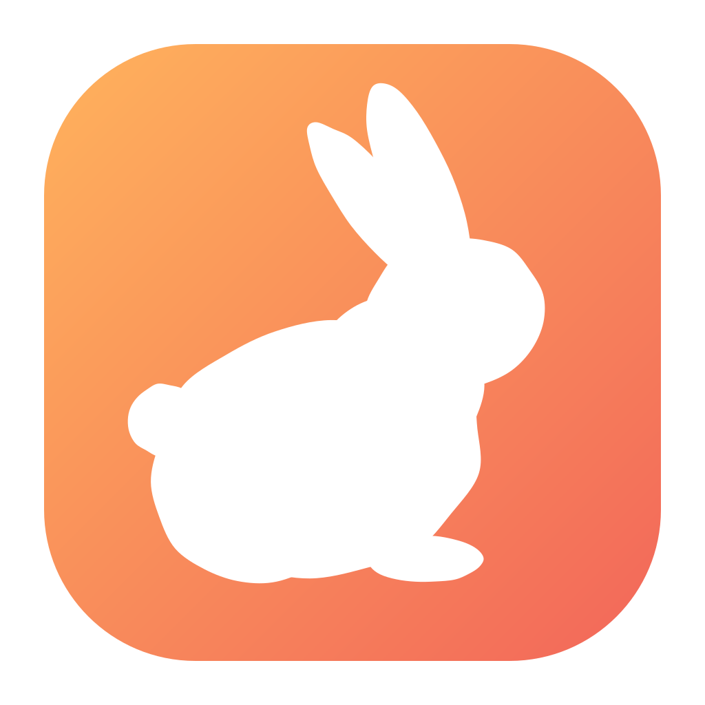

# Leveret

**Windows 向けの、小さくて扱いやすい Git クライアント。**<br>
一覧からリポジトリを選んで、変更を確かめて、コミット。それだけ。

[](#必要なもの)
[](https://v2.tauri.app/)
[](https://www.rust-lang.org/)
[](https://svelte.dev/)
[](LICENSE)

[English](README.md) · **日本語**

</div>

<picture>
  <source media="(prefers-color-scheme: dark)" srcset="docs/screenshots/dark/02-changes.png">
  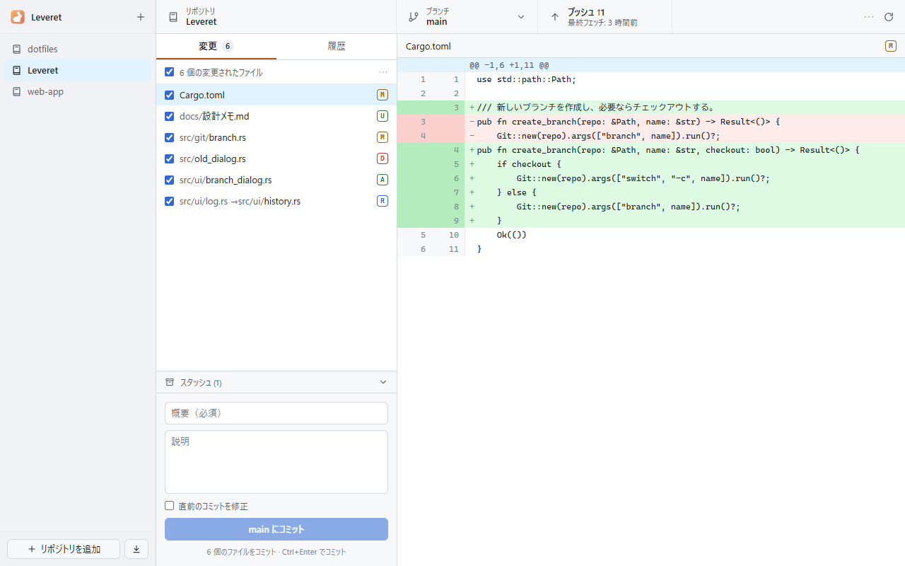
</picture>

## 機能

| | |
|---|---|
| **リポジトリ一覧** | フォルダ選択やドラッグ＆ドロップで登録し、ワンクリックで切り替え。 |
| **GitHub サインインとクローン** | ブラウザ（またはトークン）でサインインし、自分のリポジトリを選んで進捗バー付きでクローン。 |
| **選んだファイルだけコミット** | 含めるファイルにチェックを入れ、概要と説明を書いて `Ctrl+Enter`。 |
| **フェッチ / プル / プッシュ** | ツールバーのボタン1つで、そのとき必要な操作（プル、プッシュ、公開、同期）を進捗付きで実行。10 分ごとにバックグラウンドでフェッチ。 |
| **ブランチ** | 切り替え、作成、マージ、リベース、削除を1つのダイアログで。リモートブランチは追跡ブランチとしてチェックアウト。 |
| **やり直しやすい** | 破棄した変更はごみ箱へ。直前のコミットの修正や取り消し、任意のコミットのリバートやチェリーピック。 |
| **競合が分かりやすい** | 止まったマージ・リベース・リバートをバナーで表示し、解決済みにする / 続行 / スキップ / 中止。 |
| **スタッシュ** | 作業中の変更を一時的に退避して、あとで戻せます。 |
| **使いやすさ** | 各領域の幅を変更可能、右クリックメニュー、キーボードショートカット、履歴の検索。 |
| **読みやすい差分** | 行番号・ハンク見出し付き。Shift_JIS のファイルも文字化けせずに表示。 |
| **グラフ付きの履歴** | ブランチのレーン、ブランチ / リモート / タグのラベル、コミット詳細とファイルごとの差分。 |
| **ライト / ダーク** | Windows のテーマに追従。 |
| **多言語化に対応した作り** | UI の文言はすべて型付きのメッセージカタログで管理（現在は日本語）。 |
| **撮影機能を内蔵** | 全画面をバックグラウンドで撮影。ドキュメントやレビューに便利。 |
| **しっかり封じ込め** | ブラウザのタブではなくデスクトップアプリとして動作。開発者ツール・再読み込み・印刷・ズームは無効、バックエンドで入力を厳しく検証。 |
| **落ちにくい** | git の操作が重なることはなく、表示のエラーはその場で復帰。クラッシュはログに残ります。 |

> [!NOTE]
> Leveret はインストール済みの `git.exe` を呼び出すので、git の設定・資格情報ヘルパー・SSH 鍵・フックはコマンドラインと同じように動きます。

## スクリーンショット

<table>
  <tr>
    <td width="50%">
      <picture>
        <source media="(prefers-color-scheme: dark)" srcset="docs/screenshots/dark/04-history.png">
        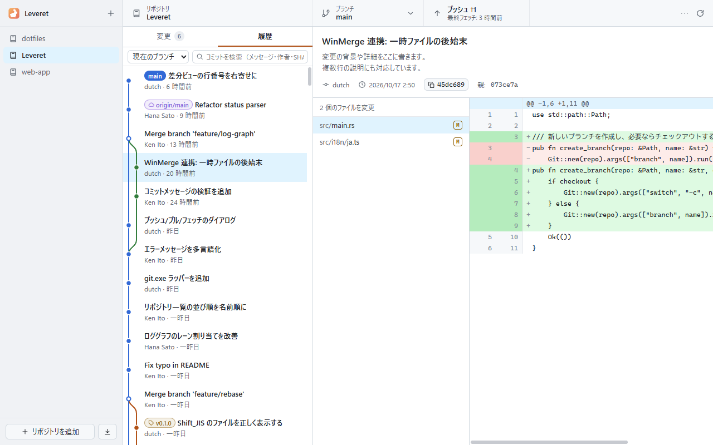
      </picture>
      <p align="center"><b>履歴</b> — グラフ、ラベル、コミット詳細</p>
    </td>
    <td width="50%">
      <picture>
        <source media="(prefers-color-scheme: dark)" srcset="docs/screenshots/dark/03-commit-message.png">
        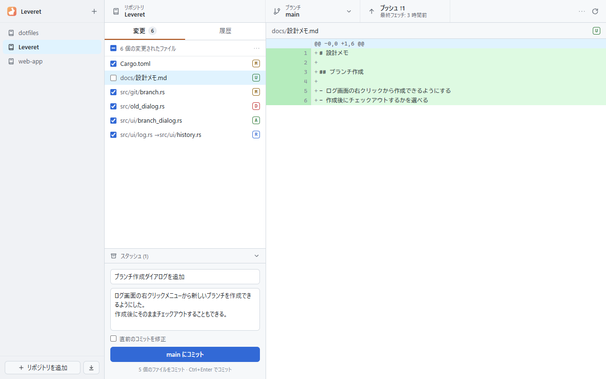
      </picture>
      <p align="center"><b>コミット</b> — チェックしたファイルだけ</p>
    </td>
  </tr>
  <tr>
    <td width="50%">
      <picture>
        <source media="(prefers-color-scheme: dark)" srcset="docs/screenshots/dark/10-branches.png">
        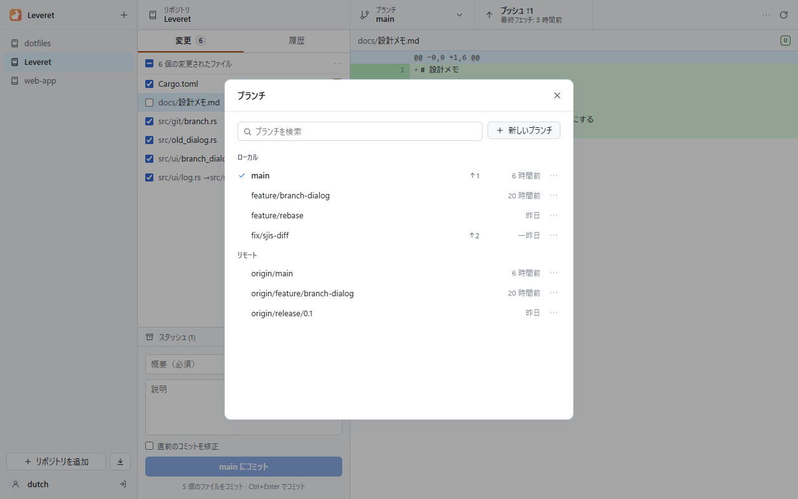
      </picture>
      <p align="center"><b>ブランチ</b> — 切り替え、マージ、リベース</p>
    </td>
    <td width="50%">
      <picture>
        <source media="(prefers-color-scheme: dark)" srcset="docs/screenshots/dark/13-rebase-conflict.png">
        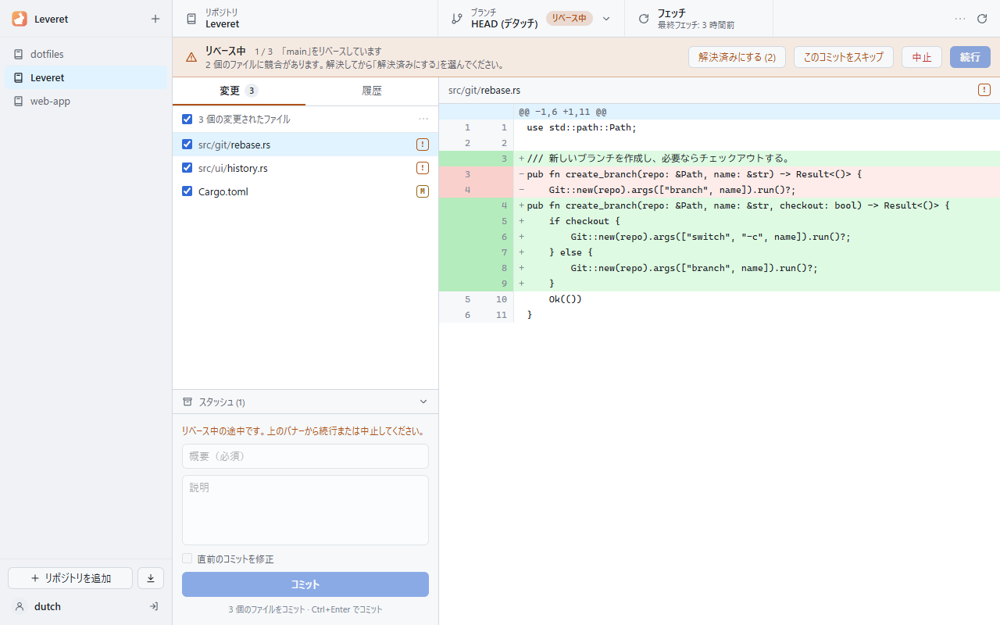
      </picture>
      <p align="center"><b>競合</b> — 解決して続行、または中止</p>
    </td>
  </tr>
  <tr>
    <td width="50%">
      <picture>
        <source media="(prefers-color-scheme: dark)" srcset="docs/screenshots/dark/12-history-menu.png">
        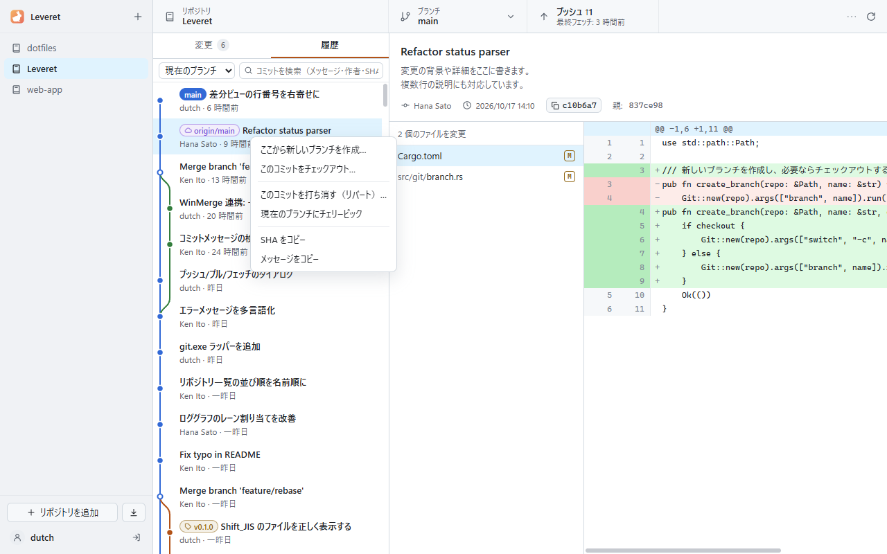
      </picture>
      <p align="center"><b>右クリック</b> — リバート、チェリーピック、ブランチ作成</p>
    </td>
    <td width="50%">
      <picture>
        <source media="(prefers-color-scheme: dark)" srcset="docs/screenshots/dark/08-clone.png">
        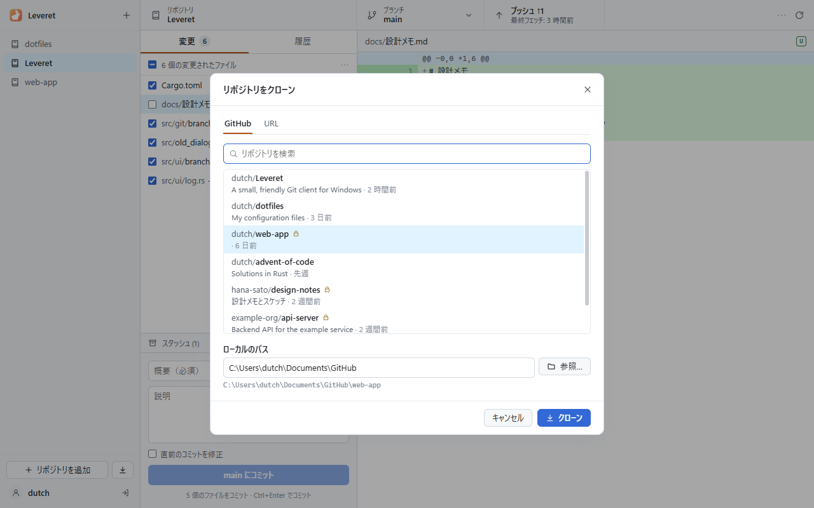
      </picture>
      <p align="center"><b>クローン</b> — GitHub アカウントから直接</p>
    </td>
  </tr>
  <tr>
    <td width="50%">
      <picture>
        <source media="(prefers-color-scheme: dark)" srcset="docs/screenshots/dark/07-sign-in.png">
        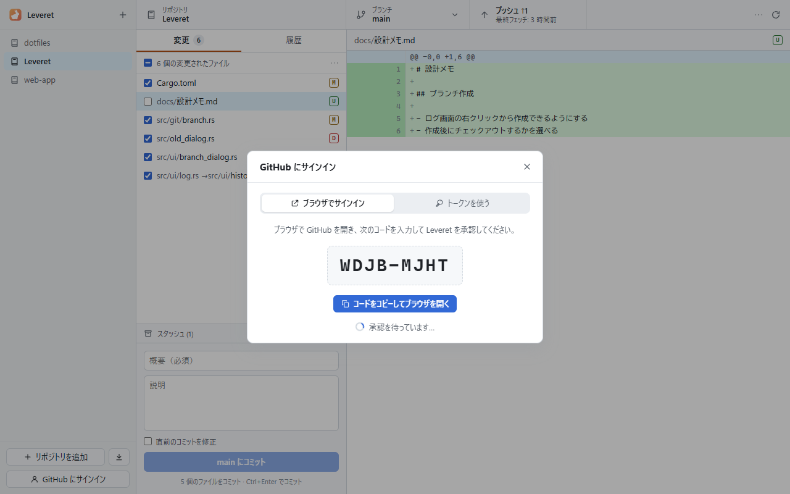
      </picture>
      <p align="center"><b>サインイン</b> — ブラウザで承認するだけ</p>
    </td>
    <td width="50%">
      <picture>
        <source media="(prefers-color-scheme: dark)" srcset="docs/screenshots/dark/01-welcome.png">
        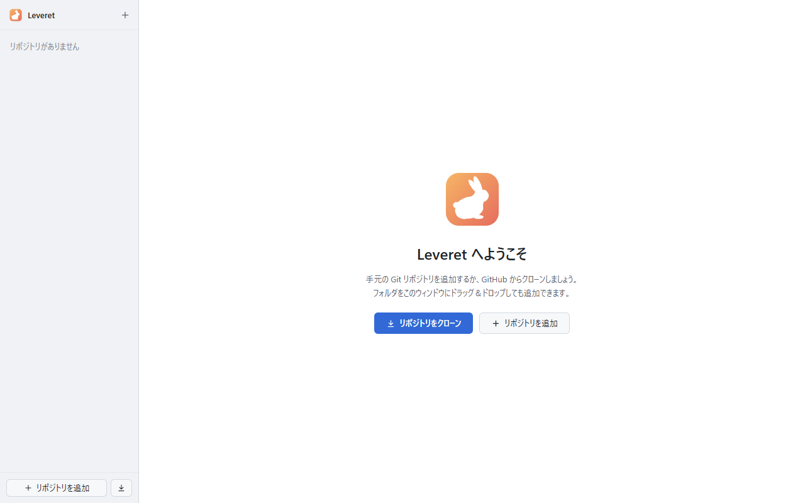
      </picture>
      <p align="center"><b>ようこそ</b> — 最初のリポジトリを追加・クローン</p>
    </td>
  </tr>
</table>

## 仕組み

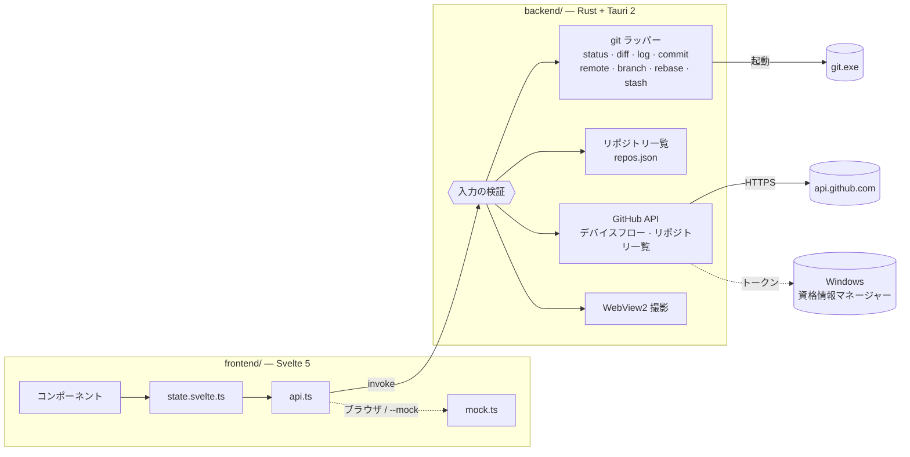

## はじめかた

### 必要なもの

- Windows 10 / 11 と WebView2 Runtime（Windows 11 には標準で入っています）
- [Git for Windows](https://gitforwindows.org/)（`PATH` に `git` があること）
- 開発する場合: [Node.js](https://nodejs.org/) 20 以上、[Rust](https://rustup.rs/)（MSVC ツールチェーン）

### ソースから起動

```bat
scripts\setup.ps1     :: ツールの確認、依存パッケージの取得、git フックの有効化
scripts\dev.bat       :: ホットリロードで起動（-Mock でダミーデータ）
```

画面だけ見たいときは `scripts\preview.bat`。Rust をビルドせず、ブラウザでダミーデータを表示します。

### リリースビルド

```bat
scripts\publish.bat   :: -> artifacts\<バージョン>\Leveret_<バージョン>.exe とその zip
```

### GitHub サインイン

**Personal Access Token** でのサインインはそのまま使えます。
**ブラウザでのサインイン**（GitHub Desktop と同じ OAuth デバイスフロー）には OAuth App が必要です。

1. GitHub → Settings → Developer settings → **OAuth Apps** → New OAuth App
   （Homepage / Callback URL は任意。例: `https://github.com/<あなた>/Leveret`）
2. **Enable Device Flow** にチェックを入れ、**Client ID** をコピーします（Client Secret は不要です）。
3. `LEVERET_GITHUB_CLIENT_ID` として渡します。ビルド時（`set LEVERET_GITHUB_CLIENT_ID=... && scripts\publish.bat`）でも、
   実行時の環境変数でも構いません。

トークンは Windows 資格情報マネージャーに保存され、git には環境変数経由でのみ渡されます。
コマンドラインやリポジトリの設定ファイルに残ることはありません。

## キーボードショートカット

| キー | 操作 |
|---|---|
| `Ctrl+1` / `Ctrl+2` | 変更 / 履歴 |
| `Ctrl+Enter` | コミット |
| `Ctrl+B` | ブランチ |
| `Ctrl+Shift+N` | 新しいブランチ |
| `Ctrl+Shift+F` / `Ctrl+Shift+L` / `Ctrl+Shift+P` | フェッチ / プル / プッシュ |
| `Ctrl+F` | 履歴を検索 |
| `F5` | 最新の状態に更新 |
| `Shift+F10`、アプリケーションキー、右クリック | コンテキストメニュー |
| `Ctrl+Shift+S` | 画面を保存 |

## スクリプト

`.bat` はターミナルからでもダブルクリックでも実行でき、引数は対応する `.ps1` に渡されます。

| スクリプト | 内容 |
|---|---|
| `scripts\setup.ps1` | ツールの確認、依存パッケージの取得、git フックの有効化 |
| `scripts\dev.bat [-Mock]` | ホットリロードで起動 |
| `scripts\preview.bat [-Scene <id>] [-Theme light\|dark] [-App]` | 画面だけ確認（ブラウザ + ダミーデータ。`-App` でデスクトップアプリとして表示） |
| `scripts\test.bat [-Fast]` | セキュリティの静的チェック、`svelte-check`、フロントのビルド、`cargo test`、`cargo clippy` |
| `scripts\security.bat [-Offline]` | セキュリティの静的チェック、`npm audit`、`cargo audit`、バックエンドのセキュリティテスト |
| `scripts\publish.bat [-SkipTests]` | リリースビルド。`artifacts\<バージョン>\` に exe とその zip を出力 |
| `scripts\screenshot.bat [-Browser] [-Theme light\|dark\|both] [-Real] [-Scenes a,b] [-Open]` | 全画面を `artifacts\screenshots\` に撮影 |
| `scripts\version.bat [<x.y.z> \| major \| minor \| patch]` | バージョンを一括変更（引数なしなら入力を求めます） |
| `scripts\clean.ps1 [-All]` | ビルド成果物を削除 |

## 撮影モード

アプリはウィンドウを表示せずに自分自身を撮影できます。

```bat
leveret.exe --capture out --mock --theme dark --scenes 02-changes,04-history
```

画面外で描画し（タスクバーにも出ず、フォーカスも奪いません）、
[`frontend/src/lib/capture.ts`](frontend/src/lib/capture.ts) のシーンを順に表示して `out\<シーン>.png` に保存し、終了します。
使用中は **Ctrl+Shift+S** で表示中の画面を `ピクチャ\Leveret\` に保存できます。

## セキュリティ

Leveret は自分自身の WebView を信頼せず、Rust のバックエンドを信頼の境界としています。

- **ブラウザ機能なし**: 開発者ツール、再読み込み、印刷、検索、ソース表示、ズーム、右クリックメニュー、
  戻る / 進む、アプリ外への移動、新しいウィンドウ、ダウンロードはすべて無効です
  （[`lockdown.rs`](backend/src/lockdown.rs)、[`lockdown.ts`](frontend/src/lib/lockdown.ts)）。
- **コマンドの検証**: 登録済みリポジトリのみ、パストラバーサル禁止、git へのオプション注入禁止、
  クローン URL は https / ssh のみ（[`security.rs`](backend/src/security.rs)）。
- **最小限の公開範囲**: 厳格な CSP、プロトタイプの凍結、WebView に許可する権限は4つだけ、shell / fs / http プラグインなし。
  ネットワーク通信はすべて Rust 側で行います。
- **継続的なチェック**: `scripts\security.bat` で静的ルール、依存関係の監査、セキュリティテストを実行します。

## 信頼性

- **git の操作は1つずつ**: 実行中はボタンやショートカットが無効になるので、ダブルクリックでコマンドが重なることはありません。
- **黙って消えない**: 破棄したファイルはごみ箱へ移動し、止まった操作はいつでも中止できます。リポジトリ一覧は安全に書き込まれ、
  読めなくなった一覧は `repos.json.bak` として残します。
- **障害を閉じ込める**: 画面の表示でエラーが起きても真っ白にはならず「表示し直す」で復帰します。バックエンドのコマンド内で
  panic が起きてもそのコマンドが失敗するだけで、内容は `%LOCALAPPDATA%\com.leveret.desktop\logs\crash.log` に記録されます。

## フォルダ構成

```text
frontend/                 Svelte の UI（package.json、vite.config.ts、tsconfig はここ）
  src/lib/state.svelte.ts   アプリの状態と操作
  src/lib/github.svelte.ts  GitHub アカウント、サインイン、クローンの状態
  src/lib/api.ts            バックエンド呼び出しの型付きラッパー
  src/lib/mock.ts           ブラウザ / --mock 用のダミーバックエンド
  src/lib/capture.ts        撮影シーンの定義
  src/lib/lockdown.ts       ブラウザのショートカットや操作を無効化
  src/lib/layout.svelte.ts  幅を変えられる領域のサイズ
  src/lib/menu.svelte.ts    アプリ独自の右クリックメニュー
  src/lib/i18n/             メッセージカタログ（locales/ja.ts がキーの定義元）
backend/                  Rust / Tauri（Cargo.toml、tauri.conf.json はここ）
  src/git/                  status、diff、log + グラフ、commit、clone、remote、branch、
                            operation（マージ / リベース / リバート）、discard、stash
  src/github.rs             デバイスフロー、トークン保存、リポジトリ一覧
  src/security.rs           WebView から来る入力の検証
  src/lockdown.rs           WebView2 の封じ込め設定
  src/capture.rs            WebView2 による画面撮影
  src/crash.rs              クラッシュログと致命的エラーの表示
  icons/generate_icon.py    icons/leveret.svg（アプリアイコン）を描くスクリプト
scripts/                  開発用スクリプト
docs/screenshots/         README で使う画像
```

## 言語の追加

1. `frontend/src/lib/i18n/locales/ja.ts` を `en.ts` などにコピーして翻訳します（型 `Messages` で全キーがそろっているかチェックされます）。
2. `frontend/src/lib/i18n/index.svelte.ts` の `catalogs` に登録します。

バックエンドのエラーは `{ code, detail }` で届き、`errors.<code>` のメッセージで表示されます。

## ロードマップ

- [x] リポジトリ一覧、変更、コミット
- [x] グラフ付きの履歴とコミット詳細
- [x] GitHub サインインとクローン
- [x] フェッチ / プル / プッシュ / 同期
- [x] ブランチ作成 / 切り替え / 削除、チェックアウト
- [x] リバート、チェリーピック、マージ、リベース、スタッシュ
- [ ] WinMerge で差分を開く
- [ ] 英語 UI
- [ ] タグ
- [ ] 対話的リベース

## コントリビュート

規約は [AGENTS.md](AGENTS.md) を参照してください。要点は、コードのコメントとコミットメッセージは英語
（`commit-msg` フックでチェック）、UI の文言はメッセージカタログ経由のみ、コミット前に `scripts\test.bat`、の3つです。

## ライセンス

[MIT](LICENSE) © valneko-twoon2
