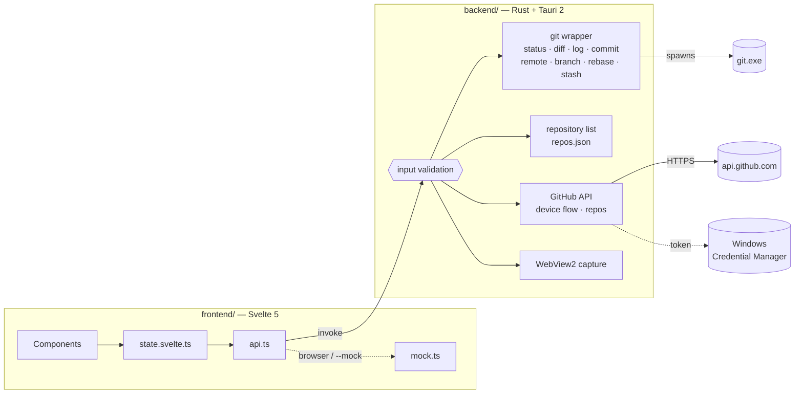

<div align="center">


# Leveret

**A small, friendly Git client for Windows.**<br>
Pick a repository from your list, review the changes, commit. That's it.

[](#requirements)
[](https://v2.tauri.app/)
[](https://www.rust-lang.org/)
[](https://svelte.dev/)
[](LICENSE)

**English** · [日本語](README.ja.md)

</div>

<picture>
  <source media="(prefers-color-scheme: dark)" srcset="docs/screenshots/dark/02-changes.png">
  
</picture>

## Features

| | |
|---|---|
| **Repository list** | Register repositories by folder picker or drag & drop, switch with one click. |
| **GitHub sign-in & clone** | Sign in through the browser (or with a token), pick one of your repositories, clone it with a progress bar. |
| **Commit what you pick** | Check the files to include, write a summary and description, `Ctrl+Enter`. |
| **Fetch, pull, push** | One toolbar button that does the right thing (pull, push, publish, sync) with progress; fetches in the background every 10 minutes. |
| **Branches** | Switch, create, merge, rebase and delete from one dialog; remote branches become tracking branches. |
| **Undo-friendly** | Discarded changes go to the Recycle Bin; amend or undo the last commit; revert or cherry-pick any commit. |
| **Clear conflicts** | A banner for stopped merges, rebases and reverts: mark resolved, continue, skip or abort. |
| **Stash** | Put work aside and bring it back later. |
| **Comfortable** | Resizable panes, right-click menus, keyboard shortcuts and history search. |
| **Readable diffs** | Line numbers, hunk headers, and Shift_JIS files decoded correctly. |
| **History with a graph** | Branch lanes, branch / remote / tag labels, commit details and per-file diffs. |
| **Light & dark** | Follows the Windows theme. |
| **Ready for translation** | All UI text lives in typed message catalogs (Japanese today). |
| **Built-in screenshots** | Captures every screen in the background — great for docs and reviews. |
| **Locked down** | A desktop app, not a browser tab: no devtools, reload, print or zoom; strict input validation in the backend. |
| **Sturdy** | Git actions never overlap, a failing view recovers in place, and crashes are logged instead of lost. |

> [!NOTE]
> Leveret drives your installed `git.exe`, so your config, credential helpers, SSH keys and hooks work exactly as on the command line.

## Screenshots

<table>
  <tr>
    <td width="50%">
      <picture>
        <source media="(prefers-color-scheme: dark)" srcset="docs/screenshots/dark/04-history.png">
        
      </picture>
      <p align="center"><b>History</b> — graph, labels, commit details</p>
    </td>
    <td width="50%">
      <picture>
        <source media="(prefers-color-scheme: dark)" srcset="docs/screenshots/dark/03-commit-message.png">
        
      </picture>
      <p align="center"><b>Commit</b> — only the checked files</p>
    </td>
  </tr>
  <tr>
    <td width="50%">
      <picture>
        <source media="(prefers-color-scheme: dark)" srcset="docs/screenshots/dark/10-branches.png">
        
      </picture>
      <p align="center"><b>Branches</b> — switch, merge, rebase</p>
    </td>
    <td width="50%">
      <picture>
        <source media="(prefers-color-scheme: dark)" srcset="docs/screenshots/dark/13-rebase-conflict.png">
        
      </picture>
      <p align="center"><b>Conflicts</b> — resolve, continue or abort</p>
    </td>
  </tr>
  <tr>
    <td width="50%">
      <picture>
        <source media="(prefers-color-scheme: dark)" srcset="docs/screenshots/dark/12-history-menu.png">
        
      </picture>
      <p align="center"><b>Right-click</b> — revert, cherry-pick, branch off</p>
    </td>
    <td width="50%">
      <picture>
        <source media="(prefers-color-scheme: dark)" srcset="docs/screenshots/dark/08-clone.png">
        
      </picture>
      <p align="center"><b>Clone</b> — straight from your GitHub account</p>
    </td>
  </tr>
  <tr>
    <td width="50%">
      <picture>
        <source media="(prefers-color-scheme: dark)" srcset="docs/screenshots/dark/07-sign-in.png">
        
      </picture>
      <p align="center"><b>Sign in</b> — approve in your browser</p>
    </td>
    <td width="50%">
      <picture>
        <source media="(prefers-color-scheme: dark)" srcset="docs/screenshots/dark/01-welcome.png">
        
      </picture>
      <p align="center"><b>Welcome</b> — add or clone your first repository</p>
    </td>
  </tr>
</table>

## How it works



## Getting started

### Requirements

- Windows 10 / 11 with the WebView2 Runtime (bundled with Windows 11)
- [Git for Windows](https://gitforwindows.org/) on `PATH`
- For development: [Node.js](https://nodejs.org/) 20+ and [Rust](https://rustup.rs/) (MSVC toolchain)

### Run from source

```bat
scripts\setup.ps1     :: check tools, install dependencies, enable git hooks
scripts\dev.bat       :: start with hot reload (add -Mock for sample data)
```

Just want to look at the UI? `scripts\preview.bat` opens it in your browser with sample data — no Rust build needed.

### Build a release

```bat
scripts\publish.bat   :: -> artifacts\<version>\Leveret_<version>.exe and a zip of it
```

### GitHub sign-in

Signing in with a **personal access token** works out of the box.
Signing in **through the browser** (the OAuth device flow, like GitHub Desktop) needs an OAuth App:

1. GitHub → Settings → Developer settings → **OAuth Apps** → New OAuth App
   (any homepage / callback URL, e.g. `https://github.com/<you>/Leveret`).
2. Tick **Enable Device Flow** and copy the **Client ID** (no client secret is needed).
3. Provide it as `LEVERET_GITHUB_CLIENT_ID` — at build time (`set LEVERET_GITHUB_CLIENT_ID=... && scripts\publish.bat`)
   or at run time as an environment variable.

The token is stored in Windows Credential Manager and handed to git only through environment variables,
so it never appears on a command line or in a repository's config.

## Keyboard shortcuts

| Keys | Action |
|---|---|
| `Ctrl+1` / `Ctrl+2` | Changes / History |
| `Ctrl+Enter` | Commit |
| `Ctrl+B` | Branches |
| `Ctrl+Shift+N` | New branch |
| `Ctrl+Shift+F` / `Ctrl+Shift+L` / `Ctrl+Shift+P` | Fetch / Pull / Push |
| `Ctrl+F` | Search the history |
| `F5` | Refresh |
| `Shift+F10`, menu key, right click | Context menu |
| `Ctrl+Shift+S` | Save a screenshot |

## Scripts

Every `.bat` works from a terminal or by double-clicking, and forwards its arguments to the matching `.ps1`.

| Script | What it does |
|---|---|
| `scripts\setup.ps1` | Checks the toolchain, installs dependencies, enables the git hooks |
| `scripts\dev.bat [-Mock]` | Runs the app with hot reload |
| `scripts\preview.bat [-Scene <id>] [-Theme light\|dark] [-App]` | UI only, in a browser with sample data (`-App`: as the desktop app) |
| `scripts\test.bat [-Fast]` | Static security rules, `svelte-check`, frontend build, `cargo test`, `cargo clippy` |
| `scripts\security.bat [-Offline]` | Static security rules, `npm audit`, `cargo audit`, backend security tests |
| `scripts\publish.bat [-SkipTests]` | Release build: `artifacts\<version>\Leveret_<version>.exe` and `Leveret_<version>_x64.zip` |
| `scripts\screenshot.bat [-Browser] [-Theme light\|dark\|both] [-Real] [-Scenes a,b] [-Open]` | Captures every screen into `artifacts\screenshots\` |
| `scripts\version.bat [<x.y.z> \| major \| minor \| patch]` | Bumps the version everywhere (prompts when run without arguments) |
| `scripts\clean.ps1 [-All]` | Removes build outputs |

## Screenshot mode

The app can photograph itself without showing a window:

```bat
leveret.exe --capture out --mock --theme dark --scenes 02-changes,04-history
```

It renders off-screen (no taskbar entry, no focus), walks through the scenes defined in
[`frontend/src/lib/capture.ts`](frontend/src/lib/capture.ts), writes `out\<scene>.png` and exits.
While using the app, **Ctrl+Shift+S** saves the current screen to `Pictures\Leveret\`.

## Security

Leveret treats its own webview as untrusted and keeps the Rust backend as the trust boundary.

- **No browser features**: devtools, reload, print, find, view-source, zoom, the context menu, back/forward,
  navigation away from the app, new windows and downloads are all disabled
  ([`lockdown.rs`](backend/src/lockdown.rs), [`lockdown.ts`](frontend/src/lib/lockdown.ts)).
- **Validated commands**: only registered repositories, no path traversal, no git option injection,
  only https / ssh clone URLs ([`security.rs`](backend/src/security.rs)).
- **Minimal surface**: strict CSP, frozen prototypes, four webview permissions, no shell / fs / http plugins;
  all network access happens in Rust.
- **Checked continuously**: `scripts\security.bat` runs static rules, dependency audits and security tests.

## Reliability

- **One git action at a time**: buttons and shortcuts are disabled while an action runs, so double clicks never start overlapping commands.
- **Nothing is lost silently**: discarded files go to the Recycle Bin, stopped operations can always be aborted, and the repository
  list is written atomically (an unreadable one is kept as `repos.json.bak`).
- **Contained failures**: an error inside a view shows a "show again" panel instead of a blank window; a panic inside a backend command
  fails only that command and is written to `%LOCALAPPDATA%\com.leveret.desktop\logs\crash.log`.

## Project layout

```text
frontend/                 Svelte UI (its own package.json, vite.config.ts, tsconfig)
  src/lib/state.svelte.ts   app state and actions
  src/lib/github.svelte.ts  GitHub account, sign-in and clone state
  src/lib/api.ts            typed wrappers for backend commands
  src/lib/mock.ts           sample-data backend for the browser and --mock
  src/lib/capture.ts        screenshot scenes
  src/lib/lockdown.ts       blocks browser shortcuts and gestures
  src/lib/layout.svelte.ts  resizable pane sizes
  src/lib/menu.svelte.ts    the app's own context menu
  src/lib/i18n/             message catalogs (locales/ja.ts defines the keys)
backend/                  Rust / Tauri (its own Cargo.toml, tauri.conf.json)
  src/git/                  status, diff, log + graph, commit, clone, remote, branch,
                            operation (merge / rebase / revert), discard, stash
  src/github.rs             device flow, token storage, repository list
  src/security.rs           validation of everything coming from the webview
  src/lockdown.rs           WebView2 hardening
  src/capture.rs            WebView2 screen capture
  src/crash.rs              crash log and fatal error message
  icons/generate_icon.py    draws icons/leveret.svg (the app icon)
scripts/                  developer scripts
docs/screenshots/         images used by this README
```

## Adding a language

1. Copy `frontend/src/lib/i18n/locales/ja.ts` to e.g. `en.ts` and translate it — the `Messages` type checks that every key is present.
2. Register it in `catalogs` in `frontend/src/lib/i18n/index.svelte.ts`.

Backend errors arrive as `{ code, detail }` and are shown through the `errors.<code>` messages.

## Roadmap

- [x] Repository list, changes, commit
- [x] History with graph and commit details
- [x] GitHub sign-in and clone
- [x] Fetch / pull / push / sync
- [x] Branch create / switch / delete, checkout
- [x] Revert, cherry-pick, merge, rebase, stash
- [ ] Open diffs in WinMerge
- [ ] English UI
- [ ] Tags
- [ ] Interactive rebase

## Contributing

See [AGENTS.md](AGENTS.md) for conventions. In short: English for code comments and commit messages
(enforced by a `commit-msg` hook), UI text only through the message catalogs, and `scripts\test.bat` before you commit.

## License

[MIT](LICENSE) © valneko-twoon2
