# Screenshots

[README](../README.md) · **English** · [日本語](screenshots.ja.md)

Every screen, captured with `scripts\screenshot.bat -Theme both` (sample data; your own repositories show your user name).
Light or dark follows your GitHub theme.

<table>
  <tr>
    <td width="50%">
      <picture>
        <source media="(prefers-color-scheme: dark)" srcset="screenshots/dark/02-changes.png">
        
      </picture>
      
Changes — check files, read the diff, commit

    </td>
    <td width="50%">
      <picture>
        <source media="(prefers-color-scheme: dark)" srcset="screenshots/dark/03-commit-message.png">
        
      </picture>
      
Commit — only the checked files

    </td>
  </tr>
  <tr>
    <td width="50%">
      <picture>
        <source media="(prefers-color-scheme: dark)" srcset="screenshots/dark/04-history.png">
        
      </picture>
      
History — graph, labels, commit details

    </td>
    <td width="50%">
      <picture>
        <source media="(prefers-color-scheme: dark)" srcset="screenshots/dark/05-history-all-branches.png">
        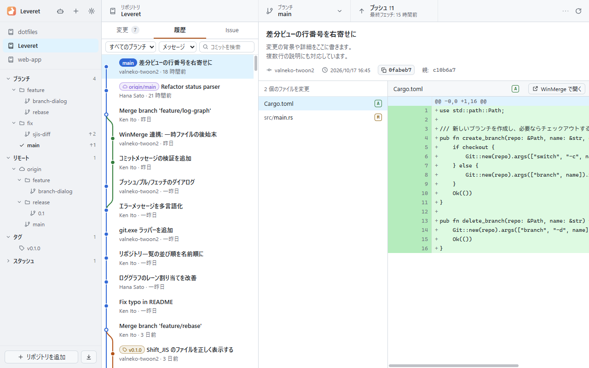
      </picture>
      
All branches at once

    </td>
  </tr>
  <tr>
    <td width="50%">
      <picture>
        <source media="(prefers-color-scheme: dark)" srcset="screenshots/dark/12-history-menu.png">
        
      </picture>
      
Right-click — revert, cherry-pick, branch off, tag

    </td>
    <td width="50%">
      <picture>
        <source media="(prefers-color-scheme: dark)" srcset="screenshots/dark/10-branches.png">
        
      </picture>
      
Branches — switch, merge, rebase

    </td>
  </tr>
  <tr>
    <td width="50%">
      <picture>
        <source media="(prefers-color-scheme: dark)" srcset="screenshots/dark/11-new-branch.png">
        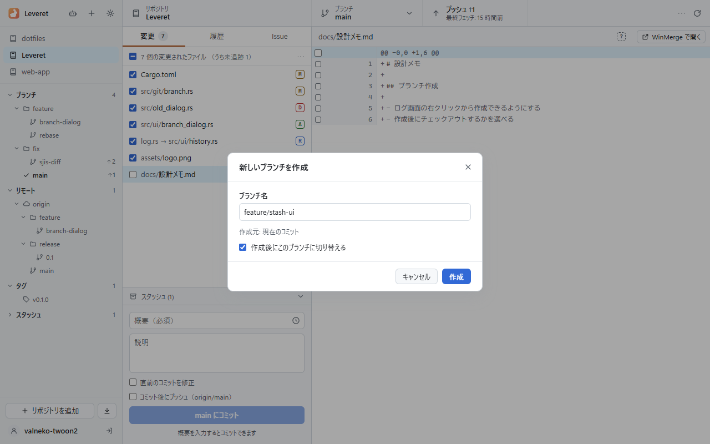
      </picture>
      
New branch

    </td>
    <td width="50%">
      <picture>
        <source media="(prefers-color-scheme: dark)" srcset="screenshots/dark/19-tags.png">
        
      </picture>
      
Tags — check out, push, delete

    </td>
  </tr>
  <tr>
    <td width="50%">
      <picture>
        <source media="(prefers-color-scheme: dark)" srcset="screenshots/dark/20-new-tag.png">
        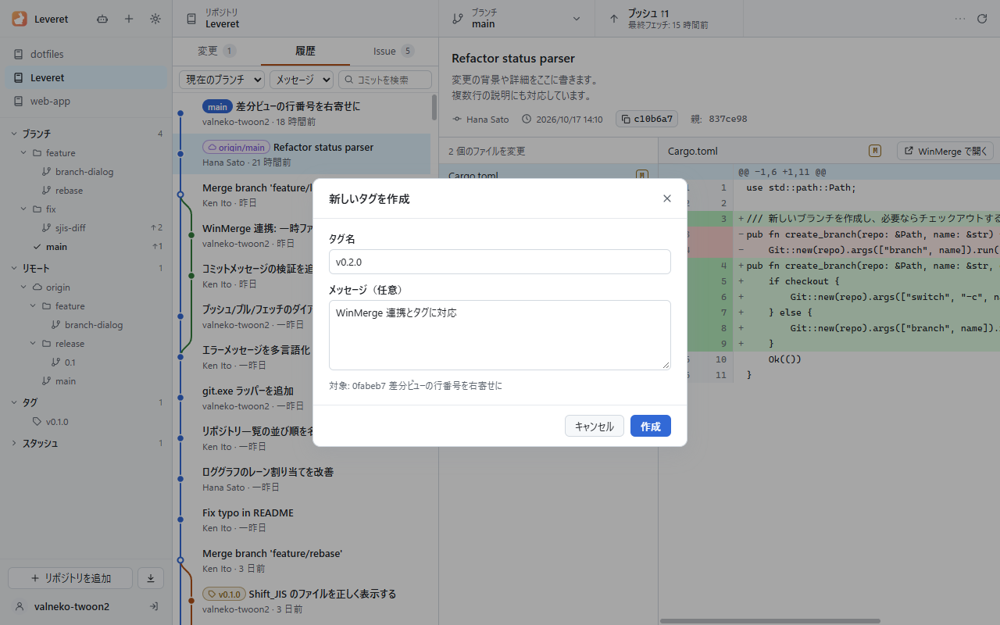
      </picture>
      
New tag — lightweight or annotated

    </td>
    <td width="50%">
      <picture>
        <source media="(prefers-color-scheme: dark)" srcset="screenshots/dark/13-rebase-conflict.png">
        
      </picture>
      
Conflicts — resolve, continue or abort

    </td>
  </tr>
  <tr>
    <td width="50%">
      <picture>
        <source media="(prefers-color-scheme: dark)" srcset="screenshots/dark/14-pushing.png">
        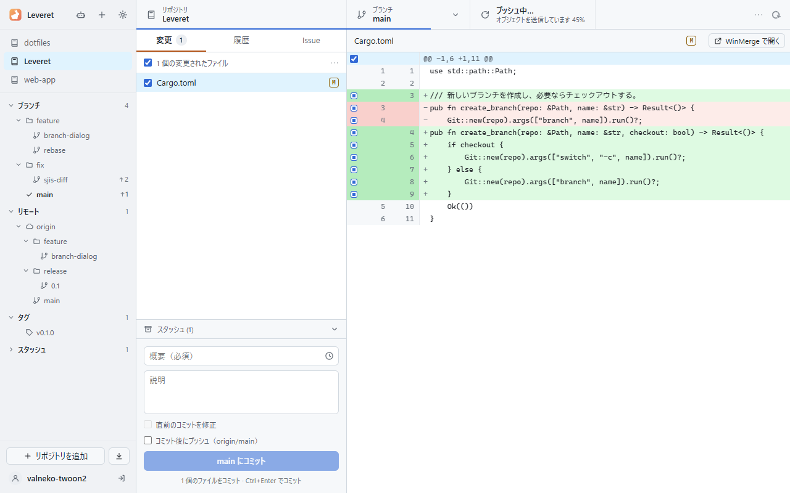
      </picture>
      
Push with progress

    </td>
    <td width="50%">
      <picture>
        <source media="(prefers-color-scheme: dark)" srcset="screenshots/dark/17-issues.png">
        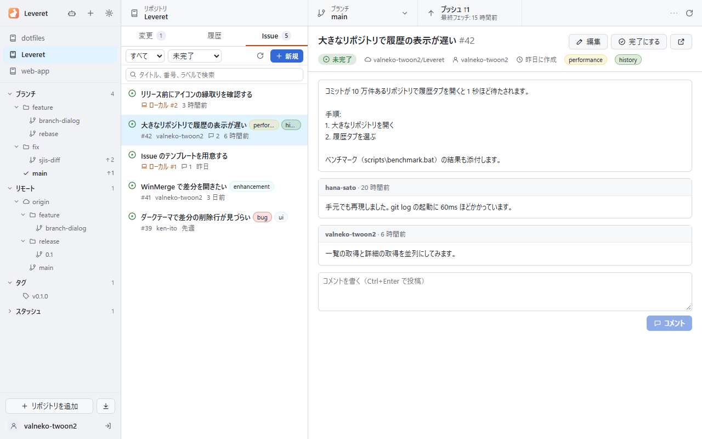
      </picture>
      
Issues — GitHub and local, publish when ready

    </td>
  </tr>
  <tr>
    <td width="50%">
      <picture>
        <source media="(prefers-color-scheme: dark)" srcset="screenshots/dark/18-new-issue.png">
        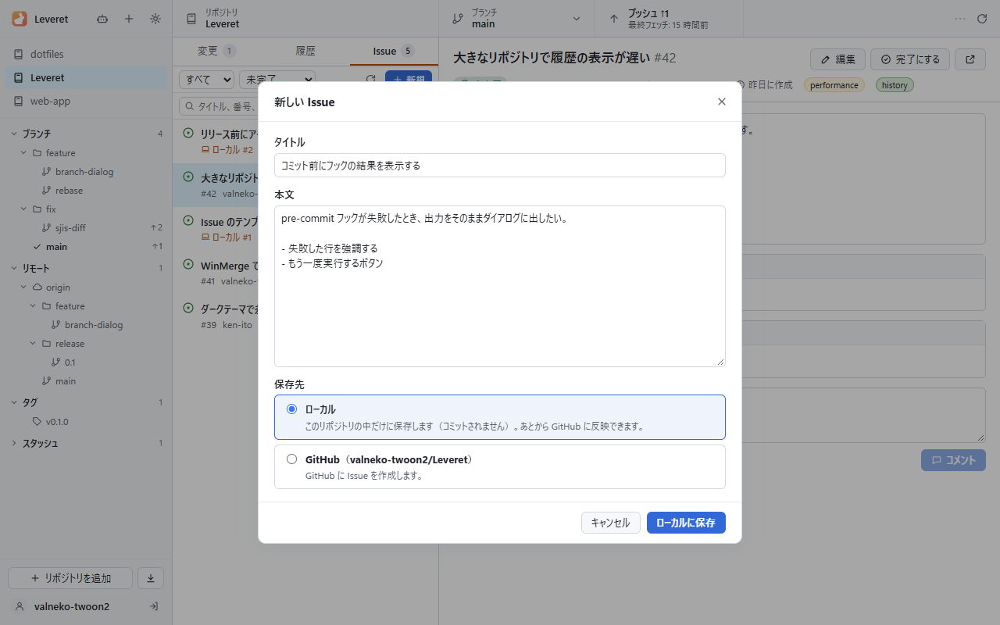
      </picture>
      
New local issue

    </td>
    <td width="50%">
      <picture>
        <source media="(prefers-color-scheme: dark)" srcset="screenshots/dark/21-settings.png">
        
      </picture>
      
Settings

    </td>
  </tr>
  <tr>
    <td width="50%">
      <picture>
        <source media="(prefers-color-scheme: dark)" srcset="screenshots/dark/22-settings-git.png">
        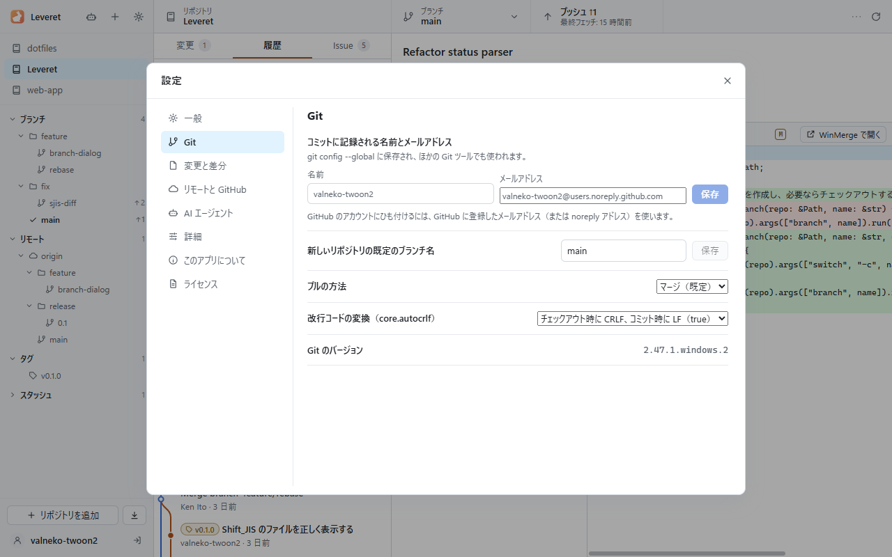
      </picture>
      
Git settings — identity, pull, line endings

    </td>
    <td width="50%">
      <picture>
        <source media="(prefers-color-scheme: dark)" srcset="screenshots/dark/23-licenses.png">
        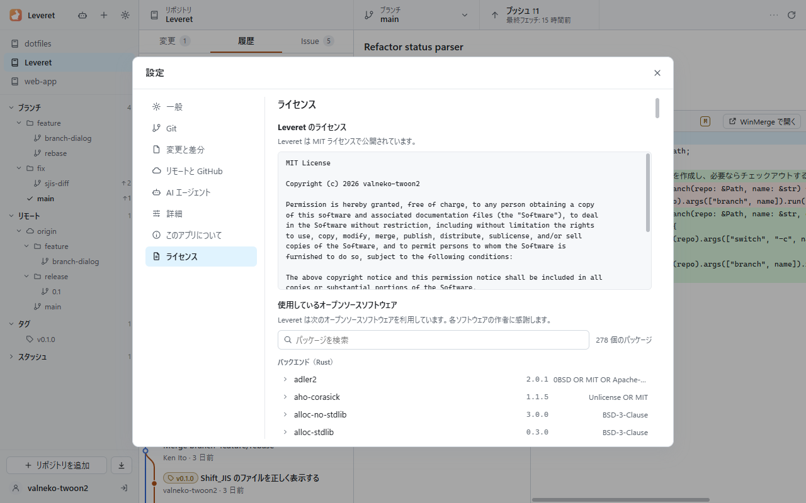
      </picture>
      
Licenses of Leveret and bundled packages

    </td>
  </tr>
  <tr>
    <td width="50%">
      <picture>
        <source media="(prefers-color-scheme: dark)" srcset="screenshots/dark/15-agents.png">
        
      </picture>
      
AI agents — access level and activity

    </td>
    <td width="50%">
      <picture>
        <source media="(prefers-color-scheme: dark)" srcset="screenshots/dark/16-performance.png">
        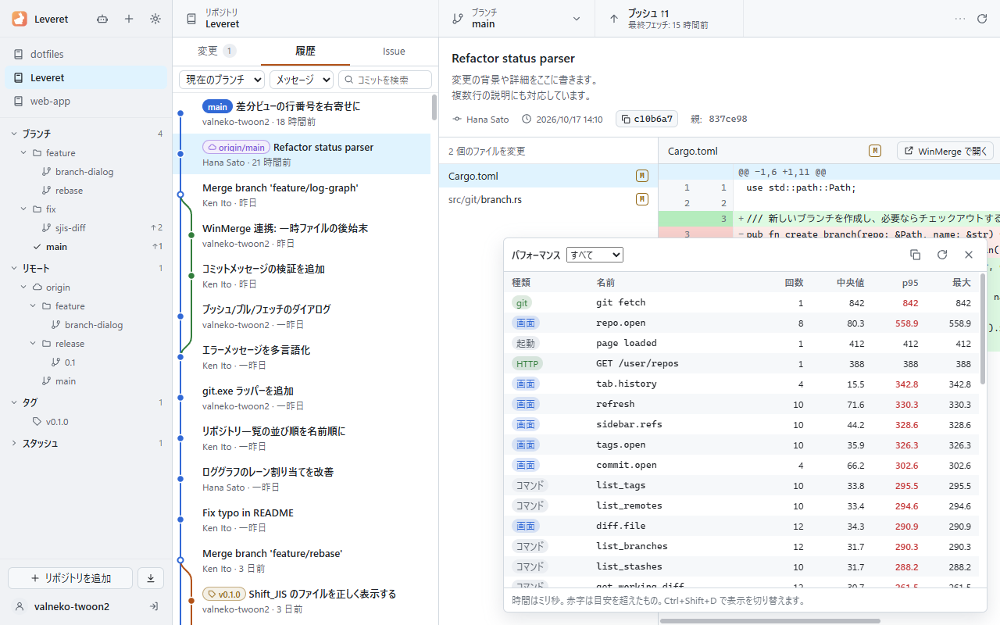
      </picture>
      
Performance — every step timed (Ctrl+Shift+D)

    </td>
  </tr>
  <tr>
    <td width="50%">
      <picture>
        <source media="(prefers-color-scheme: dark)" srcset="screenshots/dark/08-clone.png">
        
      </picture>
      
Clone from your GitHub account

    </td>
    <td width="50%">
      <picture>
        <source media="(prefers-color-scheme: dark)" srcset="screenshots/dark/09-cloning.png">
        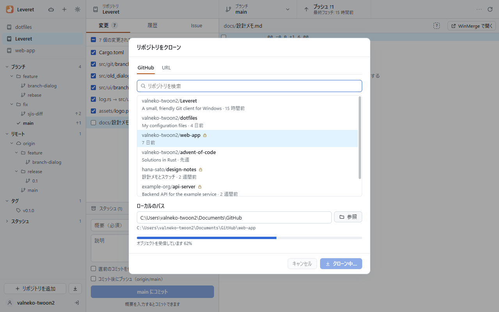
      </picture>
      
Cloning

    </td>
  </tr>
  <tr>
    <td width="50%">
      <picture>
        <source media="(prefers-color-scheme: dark)" srcset="screenshots/dark/07-sign-in.png">
        
      </picture>
      
Sign in — approve in your browser

    </td>
    <td width="50%">
      <picture>
        <source media="(prefers-color-scheme: dark)" srcset="screenshots/dark/06-error.png">
        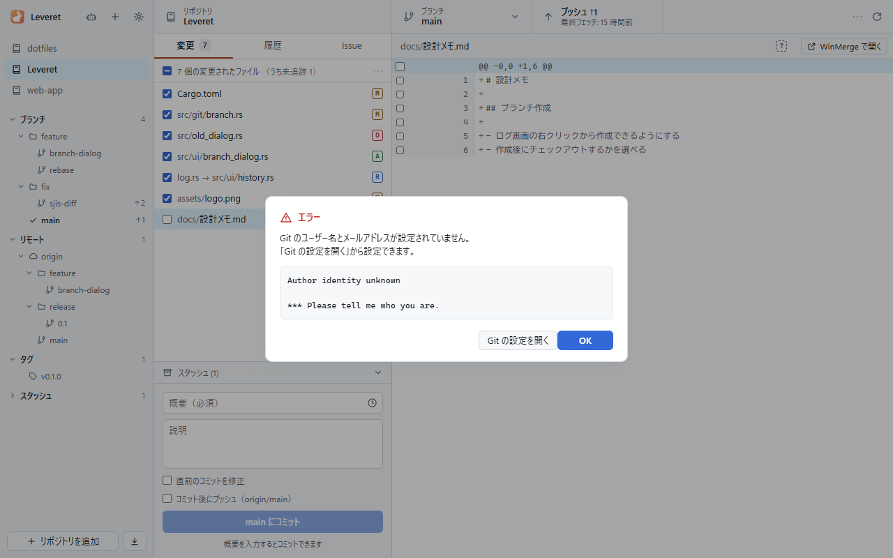
      </picture>
      
Errors with a one-click fix

    </td>
  </tr>
  <tr>
    <td width="50%">
      <picture>
        <source media="(prefers-color-scheme: dark)" srcset="screenshots/dark/01-welcome.png">
        
      </picture>
      
Welcome — add or clone your first repository

    </td>
  </tr>
  <tr>
    <td width="50%">
      <picture>
        <source media="(prefers-color-scheme: dark)" srcset="screenshots/dark/24-partial-commit.png">
        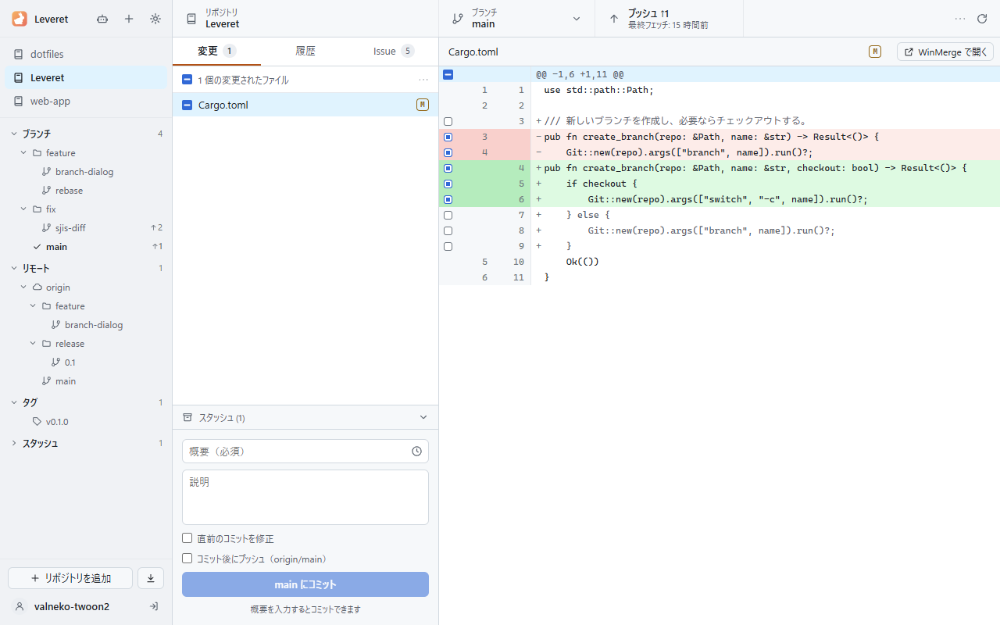
      </picture>
      
Commit only some lines or hunks

    </td>
    <td width="50%">
      <picture>
        <source media="(prefers-color-scheme: dark)" srcset="screenshots/dark/25-stash.png">
        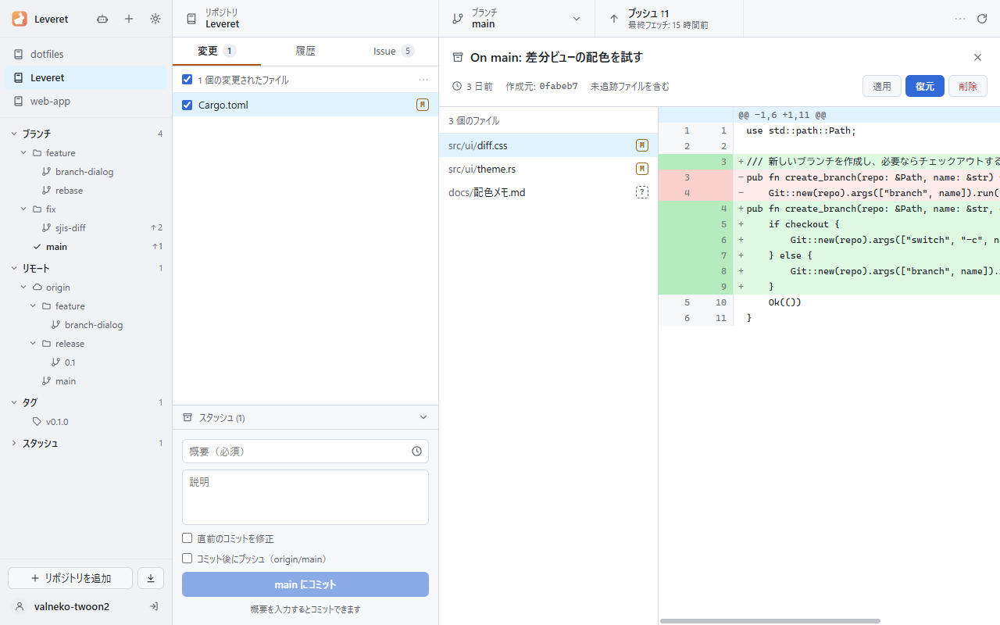
      </picture>
      
Look inside a stash

    </td>
  </tr>
  <tr>
    <td width="50%">
      <picture>
        <source media="(prefers-color-scheme: dark)" srcset="screenshots/dark/26-history-search.png">
        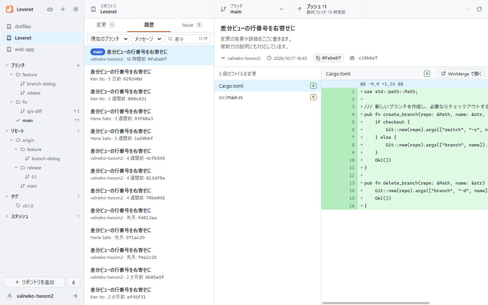
      </picture>
      
Search the whole history

    </td>
    <td width="50%">
      <picture>
        <source media="(prefers-color-scheme: dark)" srcset="screenshots/dark/27-file-history.png">
        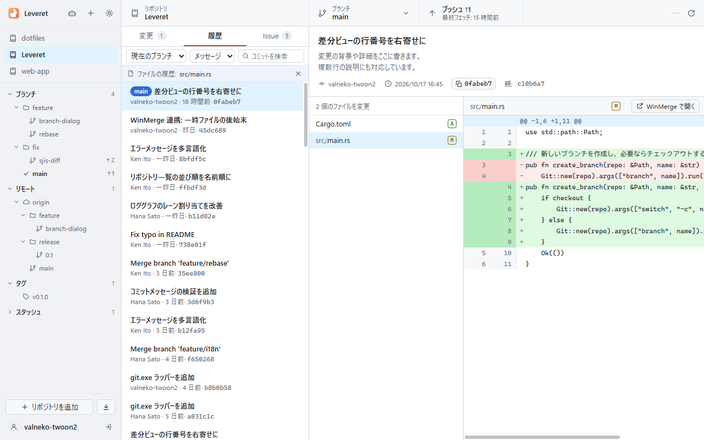
      </picture>
      
History of one file, across renames

    </td>
  </tr>
  <tr>
    <td width="50%">
      <picture>
        <source media="(prefers-color-scheme: dark)" srcset="screenshots/dark/28-blame.png">
        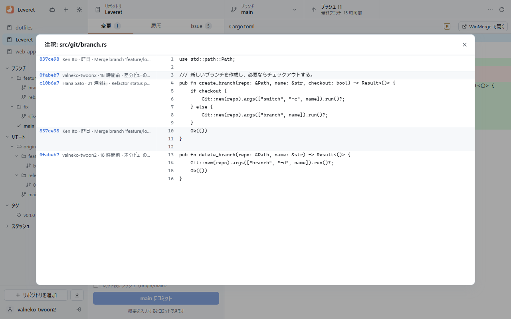
      </picture>
      
The commit that last changed each line

    </td>
    <td width="50%">
      <picture>
        <source media="(prefers-color-scheme: dark)" srcset="screenshots/dark/29-compare.png">
        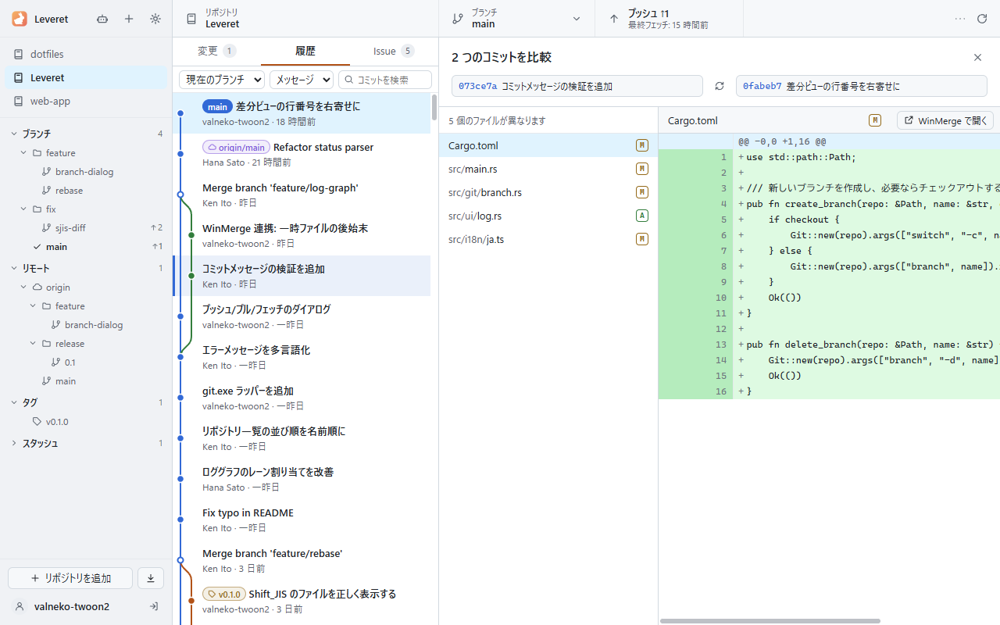
      </picture>
      
Compare any two commits

    </td>
  </tr>
  <tr>
    <td width="50%">
      <picture>
        <source media="(prefers-color-scheme: dark)" srcset="screenshots/dark/30-reset.png">
        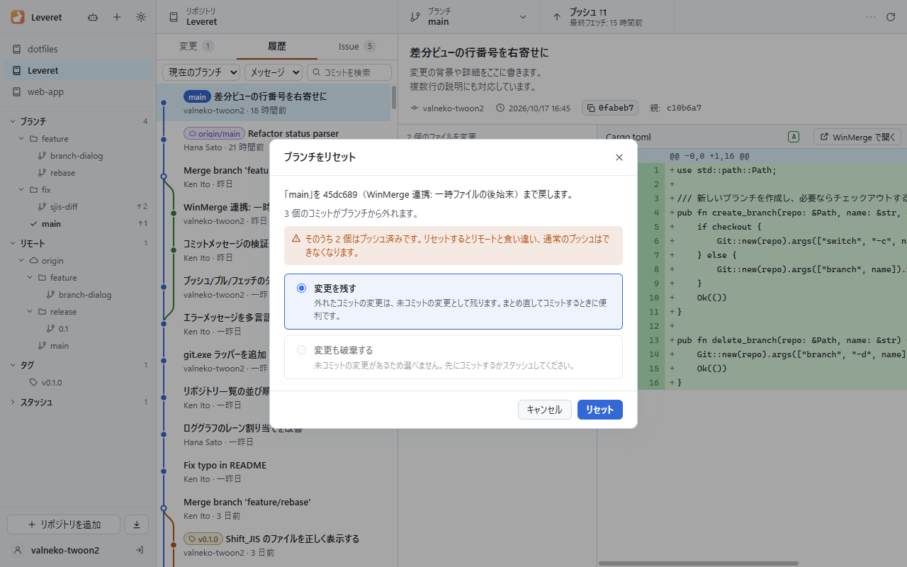
      </picture>
      
Reset the branch to a commit

    </td>
    <td width="50%">
      <picture>
        <source media="(prefers-color-scheme: dark)" srcset="screenshots/dark/31-rebase.png">
        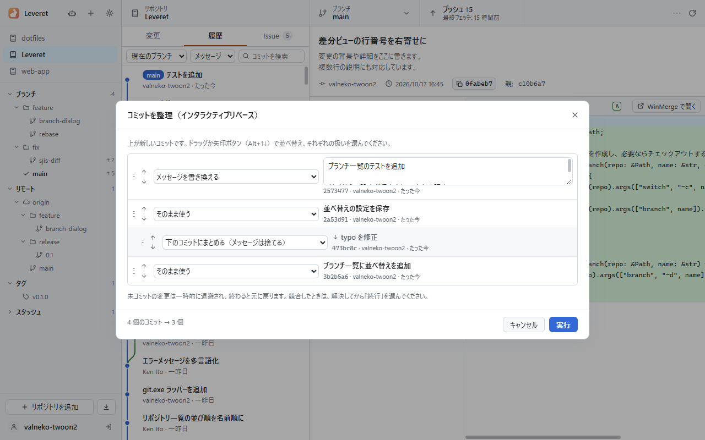
      </picture>
      
Interactive rebase

    </td>
  </tr>
  <tr>
    <td width="50%">
      <picture>
        <source media="(prefers-color-scheme: dark)" srcset="screenshots/dark/32-ref-tree.png">
        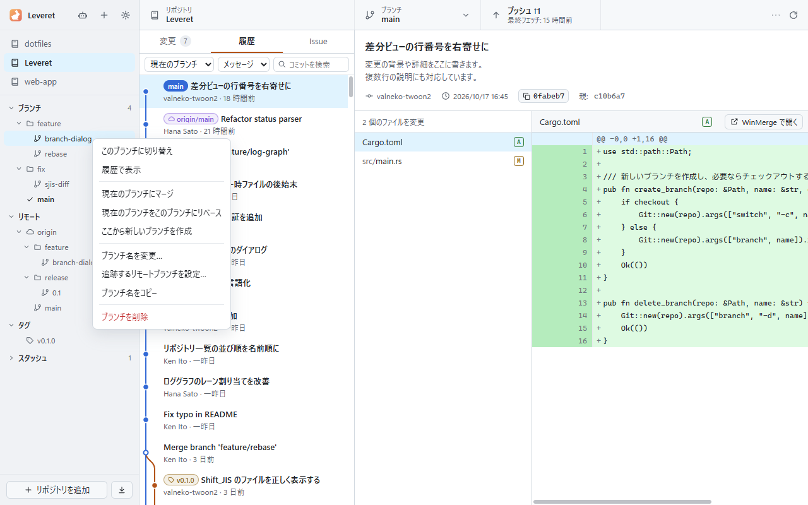
      </picture>
      
Branches, remotes, tags and stashes in a tree

    </td>
    <td width="50%">
      <picture>
        <source media="(prefers-color-scheme: dark)" srcset="screenshots/dark/33-remotes.png">
        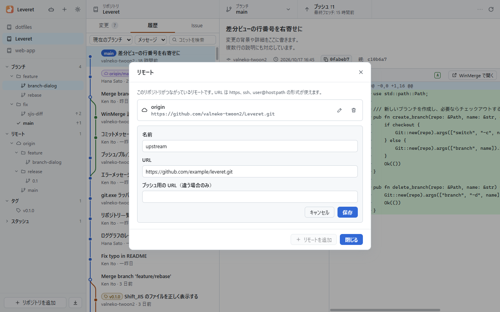
      </picture>
      
Manage remotes

    </td>
  </tr>
  <tr>
    <td width="50%">
      <picture>
        <source media="(prefers-color-scheme: dark)" srcset="screenshots/dark/34-upstream.png">
        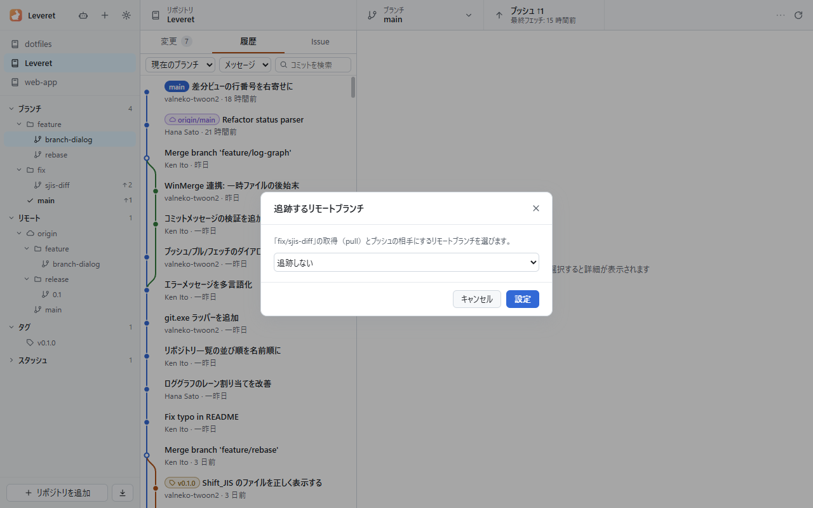
      </picture>
      
Choose the tracked remote branch

    </td>
    <td width="50%">
      <picture>
        <source media="(prefers-color-scheme: dark)" srcset="screenshots/dark/35-image-diff.png">
        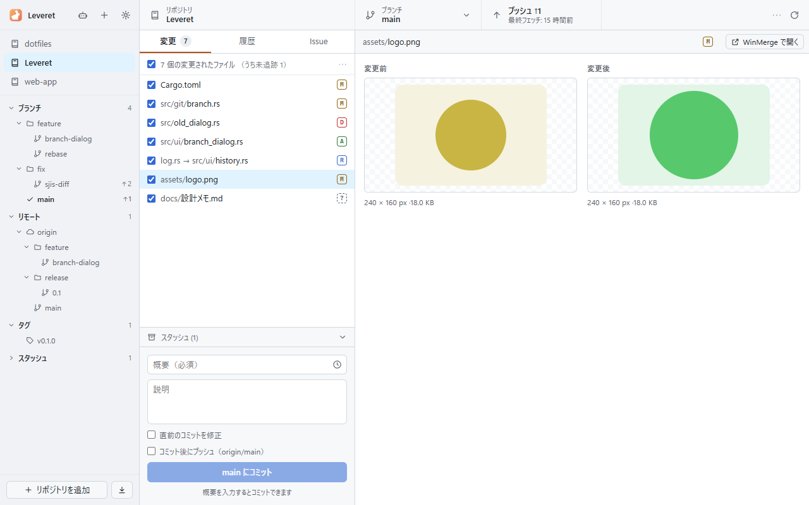
      </picture>
      
Before and after pictures

    </td>
  </tr>
</table>
